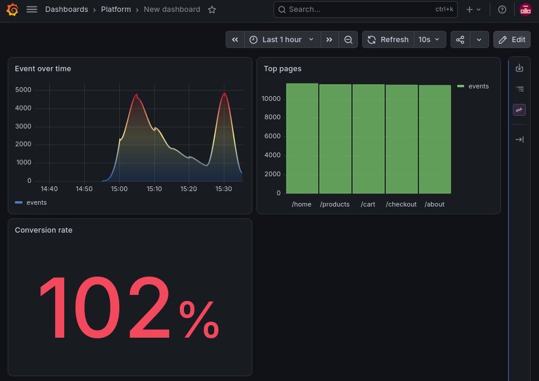

# Clickstream Platform

A local streaming analytics pipeline: fake user events flow through Kafka, get aggregated by Spark Structured Streaming into 5-minute windows, land in ClickHouse, and show up in Grafana.

```
generator (Java), Kafka, Spark Structured Streaming, ClickHouse, Grafana
```



## Stack

| Component | Purpose | URL |
|---|---|---|
| Kafka (KRaft) | Event log, topic `clickstream` (3 partitions) | localhost:9092 |
| Kafka UI | Browse topics and messages | http://localhost:8080 |
| ClickHouse | Stores aggregates in `analytics.page_stats` | localhost:8123 |
| Grafana | Live dashboards (provisioned from files) | http://localhost:3000 |
| Spark UI | Streaming job progress (while the job runs) | http://localhost:4040 |

All images, the Grafana plugin and the Maven dependencies are pinned to exact versions.

## Requirements

- Docker with Compose
- JDK 25
- Maven

## Project layout

```
compose.yaml              Docker services
clickhouse/init/          Table DDL, runs on first ClickHouse start
grafana/provisioning/     Grafana data source and dashboard provider
grafana/dashboards/       Dashboard JSON
generator/                Kafka producer for fake events
streaming-job/            Spark job: Kafka, windowed counts, ClickHouse
```

## Running it

Start the infrastructure. The `kafka-init` service creates the topic, and ClickHouse creates the table on first start.

```bash
docker compose up -d
```

Build, then start the streaming job and the generator in two terminals (job first):

```bash
mvn -q compile
SPARK_LOCAL_IP=127.0.0.1 mvn -q -pl streaming-job exec:exec
mvn -q -pl generator exec:java
```

Check the results:

```bash
docker compose exec clickhouse clickhouse-client --user dev --password dev -q "
SELECT window_start, page, type, event_count
FROM analytics.page_stats FINAL
ORDER BY window_start DESC, event_count DESC
LIMIT 15"
```

## Configuration

Generator (environment variables):

| Variable | Default | Description |
|---|---|---|
| `EVENTS_PER_SEC` | 10 | Send rate |
| `LATE_EVENTS_PERCENT` | 0 | Share of events timestamped 1–5 minutes in the past |
| `DUPLICATE_EVENTS_PERCENT` | 0 | Share of events sent twice (simulated retries) |
| `KAFKA_BOOTSTRAP_SERVERS` | localhost:9092 | Kafka address |
| `TOPIC` | clickstream | Topic name |

Streaming job: `KAFKA_BOOTSTRAP_SERVERS`, `CLICKHOUSE_URL`, `CHECKPOINT_DIR` (default `/tmp/checkpoints/clickstream`).

## How it works

- **Windows and late data:** events are counted per page and type in 5-minute windows. A 2-minute watermark accepts late events up to that limit and drops older ones. Each batch logs `droppedLate` and `stateRows`.
- **Exactly-once:** Kafka is replayable, the checkpoint stores offsets and window state, `dropDuplicatesWithinWatermark("eventId")` removes producer duplicates, and ClickHouse's `ReplacingMergeTree` keeps only the latest row per window, page and type, so replayed batches don't double-count. Always query with `FINAL`.

## Testing exactly-once

1. Reset the checkpoint and table (see below).
2. Start the job, then the generator with `DUPLICATE_EVENTS_PERCENT=10` and no late events.
3. Kill the job mid-stream with `kill -9 $(pgrep -f ClickstreamJob)`, wait a bit, restart it.
4. Stop the generator and compare its final `unique=` count with `SELECT sum(event_count) FROM analytics.page_stats FINAL`. They should match exactly.

## Resetting

```bash
rm -rf /tmp/checkpoints/clickstream
docker compose exec clickhouse clickhouse-client --user dev --password dev -q "TRUNCATE TABLE analytics.page_stats"
```

For a full reset, `docker compose down -v && docker compose up -d` and delete the checkpoint. Grafana's data source and dashboard come back from the provisioning files.

## Gotchas

- **Checkpoint vs. query changes:** adding or changing a stateful step (aggregation, dedup) or `spark.sql.shuffle.partitions` requires deleting the checkpoint.
- **Checkpoint vs. Kafka data:** if the topic is recreated, the old checkpoint points at offsets that no longer exist and the job fails with a data-loss error. Delete the checkpoint. Don't set `failOnDataLoss=false`.
- **`exec:java` needs a classic `public static void main(String[] args)`.** The streaming job uses `exec:exec` to pass Spark's JVM flags, so it runs on a real `java` launcher.
- **ClickHouse JDBC** must match the server version. Old drivers fail with `Invalid LZ4 magic byte`. Upgrade the driver and server together.
